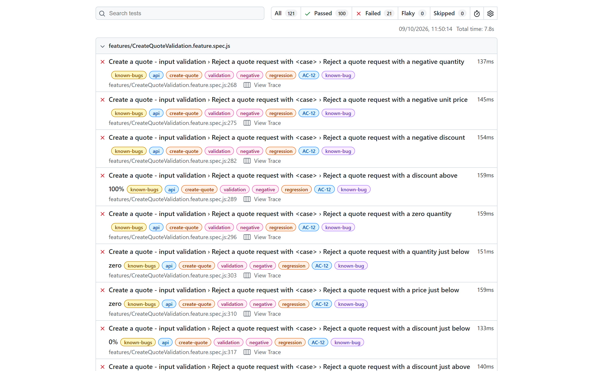

# Quote API – QA study case

A small REST API that creates price quotes, **built with known defects on purpose**, and the BDD
acceptance suite that specifies it and finds those defects.

The case shows how to go from a user story to acceptance criteria, to executable specifications, to
a report that says which criteria the service meets and which it does not.

- **API** (`api/`): TypeScript on Node.js, no framework. Two operations and an OpenAPI contract.
- **Suite**: Gherkin features run by **playwright-bdd** on the **Playwright Test** runner. HTTP calls
  use Playwright's `APIRequestContext`, so no browser is involved.
- **Acceptance criteria**: [docs/acceptance-criteria.md](docs/acceptance-criteria.md), 30 criteria:
  positive, boundary, negative, contract, performance and security.

## Result

| | Scenarios |
|---|---|
| Pass | 100 |
| Fail, because the API does not meet a criterion | 21 |
| **Total** | **121** |

24 of the 30 criteria are met. The 21 failing scenarios belong to the other 6 and are the point of
the case: each one states what the API should do, and fails because it does not.

## The API

| Operation | Purpose |
|---|---|
| `GET /api/health` | Reports that the service is up, with the server time |
| `POST /api/quotes` | Creates a quote for a customer and a list of items |
| `GET /openapi.json` | The contract, as defined in the code |

```bash
curl -X POST http://localhost:3000/api/quotes \
  -H "Content-Type: application/json" \
  -d '{"customer": "ACME Labs", "items": [{"item": "Bread", "quantity": 4, "unitPrice": 1.99, "discount": 0.75}]}'
```

```json
{
  "quote": {
    "id": "3f2b8c1e-6d4a-4b7e-9c1d-2a5e8f7b6c4d",
    "customer": "ACME Labs",
    "revision": 1,
    "status": "active",
    "lines": [
      { "item": "Bread", "quantity": 4, "unitPrice": 1.99, "discount": 0.75, "discountAmount": 5.97, "lineTotal": 1.99 }
    ],
    "total": 1.99
  },
  "message": "Quote created."
}
```

The discount is a fraction: `0.75` means 75%. A refused request is answered with HTTP 400 and a
problem details document (RFC 9457) that names the fields.

### Known defects

The contract (`api/openapi.json`) is right; the implementation does not fully honour it. The defects
are marked `KNOWN DEFECT` in the code.

| Criterion | Expected | What the API does | Failing scenarios |
|---|---|---|---|
| AC-12 Impossible quantities, prices and discounts | 400 | Creates the quote with a negative, zero or inflated total; a missing quantity is read as 1 and a missing price as 0 | 11 |
| AC-14 Null entry in the item list | 400 | **HTTP 500** | 1 |
| AC-14 Number too large to be represented | 400 | Creates the quote, with amounts returned as `null` | 2 |
| AC-14 Number sent as text | 400 | Accepts it | 1 |
| AC-17 Field that is not in the contract | 400 | Ignores it: a misspelled discount field gives the full price | 3 |
| AC-25 Errors reveal nothing | No internals in the body | Stack trace with source file paths on the 500 | 1 |
| AC-27 Body larger than 1 MB | 413 | Reads a body of any size | 1 |
| AC-28 No software name in the response (low severity) | No such header | `X-Powered-By` with the runtime and its version | 1 |

## Prerequisites

- Node.js 20.12 or newer

## How to run

```bash
npm ci

# The 100 scenarios the API must pass. The suite starts the API by itself if it is not already
# running, and stops it when the run ends.
npm test

# All 121 scenarios in one run and one report: 100 pass, 21 fail
npm run test:all

# Only the 21 scenarios of the criteria the API does not meet: all fail
npm run test:known-bugs

# Watch the scenarios run step by step, with every request and response (Playwright UI mode)
npm run test:ui

# One group of scenarios (Gherkin tags, see "Tags" below)
npm run test:smoke
npm run test:contract
npm run test:negative
npm run test:regression
npm run test:performance
npm run test:security

# One acceptance criterion, passing and failing scenarios together
npx playwright test --grep @AC-12

# Test of the tests: every scenario must fail against a stub that answers nonsense
npm run test:self-check

# HTML report of the last run (steps + the "http-exchanges" attachment of each scenario)
npm run report

# Start only the API, on http://localhost:3000
npm run api
```

No `playwright install` is needed: API testing does not use the browsers.

Defaults can be overridden with environment variables or with a local `.env` file (copy
`.env.example`; `.env` is not versioned).

| Variable | Default | Purpose |
|---|---|---|
| `QUOTE_API_BASE_URL` | `http://localhost:3000` | API under test |
| `QUOTE_API_AUTOSTART` | `true` | Start the API when it is not reachable |
| `QUOTE_API_CONTRACT` | `api/openapi.json` | Versioned OpenAPI contract |
| `QUOTE_API_STARTUP_TIMEOUT_SECONDS` | `30` | Max wait for the health check after an auto start |
| `QUOTE_API_REQUEST_TIMEOUT_MS` | `10000` | Timeout of one HTTP request |

## Structure

```
quote-api-qa-case
├── api/
│   ├── openapi.json                   the versioned contract
│   └── src/
│       ├── server.ts                       starts the API
│       ├── app.ts                          routing, HTTP protocol, error answers
│       ├── validation.ts                   request body -> quote request, or field errors
│       ├── quotes.ts                       pricing rules
│       └── openapi.ts                      the contract, defined in code
├── docs/
│   ├── acceptance-criteria.md         the acceptance criteria (AC-01 to AC-30)
│   └── images/                        screenshots of the reports
├── features/                          Gherkin specifications (the source of the expected values)
│   ├── CreateQuote.feature                 AC-01 to AC-08, AC-30: prices, discounts, totals, precision
│   ├── CreateQuoteValidation.feature       AC-09 to AC-15, AC-17, AC-18, AC-29: requests to refuse
│   ├── HttpProtocol.feature                AC-16: wrong methods (405 + Allow), unknown paths (404)
│   ├── Health.feature                      AC-21: health check
│   ├── contract/
│   │   ├── CreateQuoteContract.feature     AC-19: shape of every response of the quotes operation
│   │   └── OpenApiContract.feature         AC-20: published OpenAPI document = versioned contract
│   └── non-functional/
│       ├── Performance.feature             AC-22 to AC-24: response times
│       └── Security.feature                AC-25 to AC-28: no leak, injection, size limit
├── schemas/
│   └── quote-api.schema.ts            Zod schemas: the response contract and its types
├── steps/                             thin glue: Gherkin -> client -> assertions
├── support/
│   ├── fixtures.ts                         per-scenario `api` and `state`, Given/When/Then
│   ├── quote-api-client.ts                 HTTP client + request/response log with timings
│   ├── quote-request-builder.ts            raw JSON builder ([omitted], [null], [empty], [blank])
│   ├── scenario-state.ts                   per-scenario state
│   ├── contract.ts                         schema validation with a readable failure message
│   └── settings.ts                         environment variables and .env
├── scripts/
│   ├── self-check.mjs                      runs the suite against broken and drifted stubs
│   ├── report-screenshots.mjs              screenshots of the reports for the documentation
│   └── update-contract.ts                  writes the contract of the code to api/openapi.json
├── .github/workflows/ci.yml           type check, suite, reports, self-check and hosted smoke
├── render.yaml                        Render blueprint of the hosted API
└── playwright.config.ts               runner, reporters, projects, auto start of the API (webServer)
```

`.features-gen/` holds the spec files generated from the feature files by `bddgen`; it is rebuilt on
every run and is not versioned.

## Tags

Every scenario carries the acceptance criterion it automates and at least one execution tag.

| Tag | Meaning |
|---|---|
| `@AC-01` … `@AC-30` | The acceptance criterion of `docs/acceptance-criteria.md` |
| `@smoke` | The API is up and creates a quote with the agreed shape |
| `@contract` | Shape of the responses and of the published OpenAPI document |
| `@regression` | Business rules, validation and protocol |
| `@negative` | Requests that must be refused (`@validation`, `@protocol`) |
| `@non-functional` | `@performance` and `@security` |
| `@known-bug` | A criterion the API does not meet. The scenario fails |

The `@known-bug` scenarios run in the `known-bugs` project, outside the blocking run, so the other
100 stay a regression suite that is green when nothing broke. They are never skipped: they state the
expected behaviour and fail for the right reason. When a defect is fixed, removing the tag moves its
scenarios into the blocking run.

## Contract tests

- **Response contract.** `schemas/quote-api.schema.ts` describes every response with Zod: field
  names, types, UUID and ISO 8601 formats, enum values and nullability. Objects owned by the API are
  strict, so an added, removed or renamed field fails the scenario with the path of the field.
- **Published contract.** `OpenApiContract.feature` compares the OpenAPI document published by the
  running API with the versioned `api/openapi.json`. Any difference is a contract change, made on
  purpose with `npm run contract:update`.
- **Errors** are checked against RFC 9457 problem details.

## Reports

Every run writes two HTML reports:

| Report | Where | Best for |
|---|---|---|
| Playwright | `playwright-report/index.html` (`npm run report`) | Debugging: error, steps, trace, `http-exchanges`, response times |
| Cucumber | `cucumber-report/index.html` (open the file) | Reading the features as documentation, with the result of each step |

Each run replaces both reports, so they show the last command: `npm test` gives 100 green,
`npm run test:all` gives the 100 and the 21 failing.

`npm run docs:screenshots` runs all 121 scenarios and saves images of both reports to `docs/images/`.
It drives a browser already installed on the machine (`REPORT_BROWSER=chrome` by default, or `msedge`).



## Self-check

`npm run test:self-check` proves that the scenarios are able to fail, in two ways:

1. **Broken API.** The blocking suite runs against a stub that answers every request with a server
   error, an empty body, `{}` or an HTML page. Every scenario must fail against each of them.
2. **Contract drift.** A contract scenario runs against a stub that answers with a correct created
   quote, and must pass (the control). Then the same answer is changed in one detail at a time: a
   field renamed, removed or added, a wrong type, an identifier that is not a UUID, an unknown status,
   an empty line list (16 changes). The scenario must fail for every one of them.

The drift check covers the created quote contract. The other contracts (validation problem, problem
details, health) are covered by the first check only.

## Continuous integration

`.github/workflows/ci.yml` runs on every push and pull request: type check, the blocking suite with
an 8 minute budget, then all 121 scenarios to build the complete reports, kept as an artifact. The
self-check runs on a schedule. In CI one retry collects a trace, and a scenario that passes only on
the retry fails the run (`failOnFlakyTests`).

To publish the reports with GitHub Pages, enable Pages for the repository (source: GitHub Actions) and
set the repository variable `PUBLISH_REPORT` to `true`.

## Hosted API

`render.yaml` is a [Render](https://render.com) blueprint that hosts the API on the free plan, as a
showcase: the service sleeps after 15 minutes without requests, so the first answer can take about a
minute. The acceptance suite does not depend on it. CI tests the API it starts itself, which is also
the only place where the performance scenarios mean anything.

When the repository variable `HOSTED_API_URL` is set, the `Smoke on the hosted API` job runs the
`@smoke` scenarios against that address, on the weekly schedule and on manual runs. The same works
from a terminal:

```bash
QUOTE_API_BASE_URL=https://<service>.onrender.com QUOTE_API_AUTOSTART=false npm run test:smoke
```

## Design decisions

- **Specification first.** Every expected value comes from an acceptance criterion. Prices are written
  in the feature tables, calculated by hand, never computed by the test code.
- **Traceability.** Each scenario is tagged with its criterion; the criteria document lists the
  scenarios and the result of each criterion.
- **Positive, specific assertions.** Status code, content type, every field of every quote line, the
  total and the invariant *total = sum of line totals*.
- **Exact decimals.** Money is compared with `decimal.js`, not with a floating point tolerance.
- **Isolation.** Each scenario gets its own Playwright request context and its own state; scenarios
  run in parallel.
- **No sleeps, no retries locally.** The only wait is the readiness probe of the API (`webServer`),
  which has a documented timeout.
- **Evidence.** Every request/response of a scenario, with its response time, is attached to the
  report as `http-exchanges`.
- **Raw request bodies.** Bodies are sent byte for byte, so negative scenarios can omit fields, send
  `null`, or send malformed JSON.

## Limits

- Quotes are not stored and there is no read operation, so the scenarios verify the response, not
  that a quote exists afterwards.
- The performance scenarios measure one machine, with the API on the same host. They detect a
  regression; they say nothing about capacity.
- The security scenarios cover what can be seen in a request and its response. The API has no
  authentication.

## License

[MIT](LICENSE)
